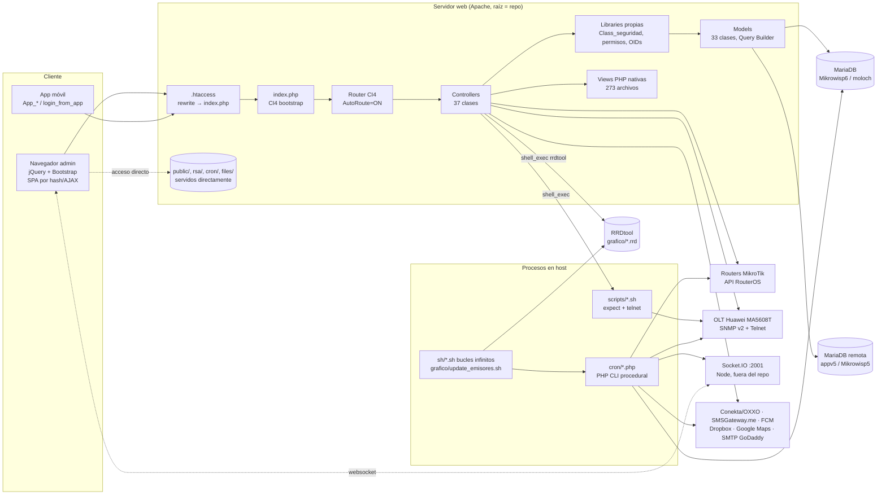
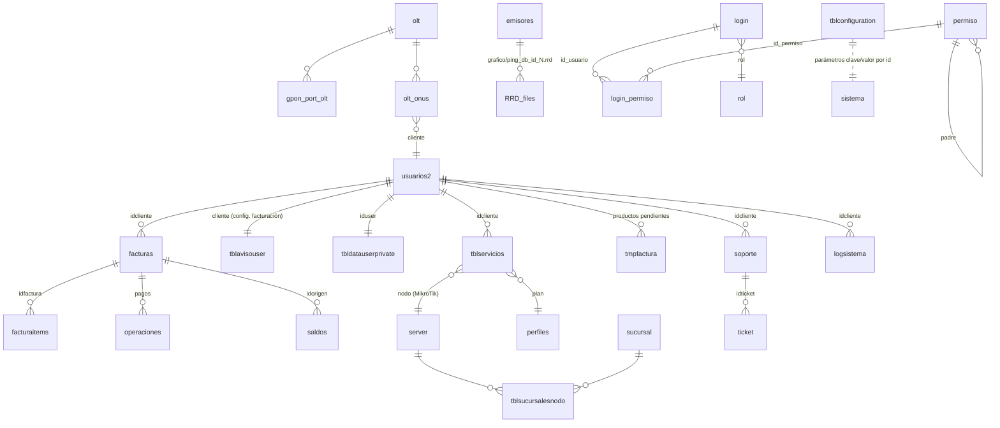

# Auditoría técnica — panel-networking

| Campo | Valor |
|---|---|
| Ruta auditada | `C:\xampp\htdocs\panel-networking` |
| Repositorio | `origin` → `github.com/joselugo/panel-networking`, rama única `main`, 1 commit (`e8c678d first commit`, 2026-10-20) |
| Fecha de auditoría | 2026-10-20 |
| Tipo | Solo lectura (no se modificó ningún archivo del proyecto; este documento es el único archivo nuevo) |
| Acceso a BD | **No**. No hay cliente `mysql` en la máquina, no existe `.env` y la BD configurada (`localhost/moloch`) no es accesible desde este equipo. El esquema se infirió del código. |
| Acceso a crontab | **No**. El equipo es Windows/XAMPP (sin `crontab`). Las frecuencias de los crons se **infirieron** del código y se marcan como tales. |

> **Convención:** las credenciales se referencian por archivo y línea, **nunca por valor**. Todo lo marcado como *(inferido)* no se pudo verificar contra el servidor real.

---

## Resumen ejecutivo

### Qué es el sistema
Panel de administración para un **proveedor de internet (WISP/FTTH)**. Gestiona clientes, servicios, facturación y cobranza (incluye referencias OXXO vía Conekta), cortes automáticos por morosidad en routers **MikroTik** (API RouterOS), aprovisionamiento de ONUs en OLTs **Huawei MA5608T** (SNMP + Telnet/expect), monitoreo de emisores/antenas (ping + RRDtool), tickets de soporte, calendario de instalaciones, almacén, cotizaciones, SMS y una app móvil auxiliar. El esquema de datos (`Mikrowisp6`, `tblservicios`, `tblavisouser`, `usuarios2`…) y los assets (`mikrowisp.css/js`) indican que deriva del producto **Mikrowisp** o que se construyó sobre su base de datos. Marcas en el código: *Netium* (`app.netium.com.mx`) y *Moloch* (`app.moloch.mx`, `baseURL` actual).

### Stack
- **PHP** ≥ 7.2 (declarado). La máquina local tiene PHP 8.2.12, pero el código no se ha probado allí.
- **CodeIgniter 4, versión pre-release** (`"codeigniter4/framework": "^4@rc"`). **`vendor/` y `composer.lock` no existen**: el framework no está en el repo y la app no arranca tal como está.
- **MySQL/MariaDB** (el volcado indica MariaDB 10.1.47 sobre Debian 9). Driver `MySQLi`.
- Frontend: plantilla de administración Bootstrap 4 + jQuery 3.2.1 (tema "Color Admin"), navegación de tipo SPA cargando fragmentos por AJAX (`#modulo/metodo`, `data-toggle="ajax"`).
- Servicios auxiliares que **no están en el repo**: un servidor **Socket.IO** en `localhost:2001` (Node), `gammu-smsd` (módem SMS), `rrdtool`, `expect`/`telnet`, `mysqldump`.

### Estado general
**Crítico.** El sistema funciona sobre convenciones de código previas a CI4 (sesiones nativas, `session_start()` en cada controlador, permisos verificados a mano en cada método) y presenta vulnerabilidades explotables **sin autenticación**. El repositorio contiene secretos de producción. No hay tests, migraciones ni logging de aplicación.

### Top 5 riesgos (detalle en Anexo E)

1. 🔴 **Secretos de producción versionados en el repo y servidos por HTTP.** `rsa/private.rsa` (clave privada para firmar JWT), contraseñas de BD (incluido `root`), llaves privadas de Conekta, SMTP, clave de servidor de FCM, credenciales de un MikroTik y de Telnet hacia OLTs. Como la **raíz web es la raíz del proyecto**, `https://<host>/rsa/private.rsa` es descargable. → **Rotar todo de inmediato.**
2. 🔴 **Scripts de cron ejecutables por HTTP sin autenticación.** `cron/*.php` está bajo la raíz web y sin `.htaccess`. Una petición a `/cron/cortes.php` o `/cron/verificacion_de_morosos.php` suspende clientes y aplica cargos de reconexión. `/cron/backup.php` hace un volcado de la BD y lo sube a Dropbox.
3. 🔴 **Ejecución de comandos del sistema (RCE / inyección de comandos).** `shell_exec`/`exec` con entrada de usuario sin escapar: `Fiber::validar_olt` y `Fiber::save_new_olt` (POST `ip/usuario/contrasenia`), `Fiber::olt_one_command` (método **público y sin autenticación**, accesible por auto-routing), y subida de archivos sin restricción de extensión a `public/uploads/reportes/` (con nombre original, ejecutable por Apache).
4. 🔴 **Autenticación rota.** `Auth::create` (`POST /api/auth`) emite un JWT válido si `email === password`, incluso con ambos vacíos. Las contraseñas usan **MD5 sin sal**. No hay regeneración de ID de sesión. CSRF está desactivado globalmente. El JWT se firma con una clave privada que es pública (punto 1).
5. 🔴 **Endpoints sin control de acceso + auto-routing activo.** Hay 100 métodos públicos de controladores sin verificación de sesión. Varios exponen datos o acciones: `App_dashboard::index` (resumen financiero), `App_egresos::*`, `Facturacion::delete_cliente`, `Clientes::migrar`, `Index::mib` (ejecuta un script Telnet), `Oxxo::oxxorecurrente`/`update` (operan en Conekta), `Api::uroboros` (se conecta a un MikroTik con credenciales embebidas). También hay **inyección SQL** en filtros de fecha (`Model_finanzas.php:23`, `Model_reportes.php`, etc.).

Otros hallazgos operativos relevantes: el cron de facturación tiene la fecha **fija en `16-01-2021`** (`cron/facturacion.php:9`), así que no factura con la fecha del día. Hay 70 llamadas a la API de CodeIgniter 3 (`$this->load->…`, `$this->input->…`) que fallan en CI4. Se versionaron 230+ archivos subidos por usuarios (`public/uploads/soporte`), lo que implica posibles datos personales en el repo.

---

## Diagrama de arquitectura



Flujo típico de una petición: `GET /clientes/lista` → `.htaccess` reescribe a `/index.php/clientes/lista` → CI4 auto-route → `App\Controllers\Clientes::lista()`. El constructor llama a `session_start()`, el método comprueba `$_SESSION['id_usuario8291']` y llama a `Class_seguridad::verificar_permiso()` (BD `login_permiso`). Después invoca `Model_*` (Query Builder sobre `default`) y responde con `echo view(...)` (fragmento HTML) o con `echo json_encode(...)`.

---

## 1. Visión general del proyecto

### 1.1 Versión de framework y PHP
| Elemento | Evidencia | Valor |
|---|---|---|
| Framework | `spark`, `app/Config/*`, `composer.json` | CodeIgniter 4 (requisito `^4@rc`, versión **release candidate**) |
| Estructura | `README.md` es el del *appstarter* de CI4 "pre-release" | Proyecto creado a partir de CI4 4.0.0-rc (≈ 2019-2020) |
| PHP mínimo | `index.php:4`, `composer.json` | `>=7.2` |
| PHP local | `php -v` | 8.2.12 (XAMPP). **CI4 RC no es compatible con PHP 8.x** *(inferido; no se pudo arrancar por falta de `vendor/`)* |
| Ruta del framework | `app/Config/Paths.php` | `vendor/codeigniter4/framework/system` → **ausente** |

### 1.2 Estructura de directorios
```
panel-networking/            ← raíz web (index.php aquí, NO en public/)
├── index.php                front controller (modificado para vivir en la raíz)
├── .htaccess                rewrite + CI_ENVIRONMENT=production + límites PHP
├── spark                    CLI de CI4 (no se usa para tareas)
├── composer.json            appstarter CI4
├── env                      plantilla (todo comentado); no existe .env
├── gzip                     ⚠ cabecera de un mysqldump (837 B) creada por error
├── app/
│   ├── Config/              28 archivos de configuración CI4 + Boot/
│   ├── Controllers/         37 controladores (≈ 20 600 líneas)
│   ├── Models/              33 modelos (≈ 10 900 líneas)
│   ├── Views/               273 vistas PHP
│   ├── Filters/AuthFilter.php
│   ├── Libraries/           librerías propias + vendors copiados a mano (103 MB)
│   ├── Database/{Migrations,Seeds}   vacíos
│   └── Helpers/, Language/, ThirdParty/   vacíos
├── public/                  css, js, plugins (28 MB), images, uploads (24 MB), socket.io, game
├── cron/                    26 scripts PHP procedurales + vendors (Net_RouterOS, ElephantIO)
├── scripts/                 10 scripts expect/telnet para OLT Huawei
├── sh/                      3 scripts de arranque/bucle (init.d)
├── grafico/                 64 bases RRD + scripts rrdtool
├── rsa/                     ⚠ par de claves RSA (privada incluida)
├── files/pdfs/              PDFs generados
├── tests/_support/          soporte del framework (sin tests de la app)
└── writable/                cache, session, uploads (logs/ no existe)
```

### 1.3 composer.json
- `require`: `php >=7.2`, `codeigniter4/framework ^4@rc`.
- `require-dev`: `mikey179/vfsstream 1.6.*`, `phpunit/phpunit ^7.0`.
- `scripts.post-update-cmd`: `composer dump-autoload`.
- No declara autoload propio. Las dependencias reales (mPDF, PhpSpreadsheet, phpseclib, Conekta, SMSGateway.me, PEAR2 Net_RouterOS, firebase/php-jwt, ElephantIO) **están copiadas** en `app/Libraries/` y `cron/` y se cargan con `require_once` manuales.
- `composer validate`: válido. `composer audit`: "No packages - skipping audit" (no hay lock).

### 1.4 Variables de entorno y configuración
| Archivo | Contenido relevante |
|---|---|
| `env` | Plantilla CI4 sin ninguna variable activa. **No existe `.env`**: toda la configuración está fija en `app/Config/*.php`. |
| `.htaccess:15` | `SetEnv CI_ENVIRONMENT production` |
| `app/Config/App.php:24` | `baseURL = https://app.moloch.mx/` |
| `app/Config/App.php:102` | `appTimezone = America/Chicago`. El código fuerza `America/Mexico_City` con `date_default_timezone_set` en cada controlador. |
| `app/Config/Database.php:33-53` | Grupo `default`: `localhost`, BD `moloch`. ⚠ usuario y contraseña en texto plano (L36-37). |
| `app/Config/Database.php:56-76` | Grupo `version5`: host remoto `appv5.netium.com.mx`, BD `Mikrowisp5`. ⚠ credenciales en texto plano (L59-60). |
| `app/Config/Encryption.php:24` | `key = ''` (vacía) |
| `app/Config/Email.php` | Valores por defecto (`mail`). El correo real se configura en el código (ver §8). |

> Inconsistencia: CI4 apunta a la BD `moloch`, pero los crons, los backups y `Class_connet` apuntan a `Mikrowisp6`. Hay que confirmar cuál es la BD de producción.

### 1.5 Entornos
`app/Config/Boot/{development,production,testing}.php` son estándar. Producción: `display_errors=0`, `CI_DEBUG=0`. Sin embargo, `App_dashboard.php:3-5` fuerza `display_errors=1` y `E_ALL` en tiempo de ejecución, y `Class_connet.php:2` fuerza `error_reporting(E_PARSE)`.

### 1.6 Control de versiones
- Una sola rama (`main`) y un solo commit: el historial anterior se perdió o se aplanó.
- `.gitignore` estándar de CI4 que excluye `.env` y `vendor/`, pero **no excluye** `rsa/`, `public/uploads/`, `files/`, `grafico/*.rrd` ni `backup/`. Su última línea está corrupta: `/phpunit*.xmlbackup/Mikrowisp6_backup_cron_10-19-2021.sql.zip` (dos reglas pegadas). Eso confirma que hubo backups de BD dentro del árbol del proyecto.
- 5 008 archivos versionados.

---

## 2. Arquitectura y flujo de aplicación

### 2.1 Patrón
MVC de CI4 **de nombre**. En la práctica:
- Los controladores generan HTML en cadenas (`Index::home`, `Class_seguridad::pintar_menu`), consultan permisos y orquestan llamadas a equipos de red.
- Los modelos extienden `CodeIgniter\Model`, pero **no usan** sus capacidades (`$table`, `$allowedFields`, validación). Cada uno abre su conexión con `\Config\Database::connect('default')` en el constructor y usa Query Builder.
- No hay capa de servicios. La lógica de negocio (facturación, cortes) está duplicada entre controladores y `cron/`.

### 2.2 Punto de entrada y bootstrap
- `index.php` (raíz): valida la versión de PHP, define `FCPATH`, carga `app/Config/Paths.php` y después `vendor/codeigniter4/framework/system/bootstrap.php`.
- `app/Config/Events.php:22` gestiona el buffer de salida en `pre_system` y activa el toolbar si el entorno no es de producción.
- `app/Common.php` está vacío.

### 2.3 Routing (`app/Config/Routes.php`)
| Línea | Regla |
|---|---|
| 60-65 | Namespace `App\Controllers`, controlador por defecto `Index`, **`setAutoRoute(true)`** |
| 75 | `GET /` → `Index::index` |
| 78 | `resource('api/auth')` → `Auth` |
| 79 | `resource('api/user')` → `User` (**el controlador `User` no existe**) |

Con auto-routing, **cualquier método público de cualquier controlador es una URL** (`/controlador/metodo/arg1/arg2`), incluidos los helpers internos que se declararon `public` por descuido (por ejemplo `Fiber::olt_one_command($id_olt, $command)`).

### 2.4 Hooks / filtros (CI4)
`app/Config/Filters.php`:
- Aliases: `csrf`, `toolbar`, `honeypot`, `authFilter` → `App\Filters\AuthFilter`.
- Globales `before`: **vacío** (CSRF y honeypot comentados). `after`: `toolbar`.
- `authFilter` solo protege `api/user` y `api/user/*`, que apuntan a un controlador inexistente. **En la práctica ningún filtro protege la aplicación.**

`AuthFilter.php` lee `Authorization: Bearer`, valida con **HS256** usando como secreto el contenido de la clave privada RSA y no verifica que la cabecera exista (`$arr[1]` sin comprobar).

### 2.5 HMVC / módulos / PSR-4
- Sin HMVC. `app/Config/Modules.php` es estándar.
- PSR-4: `Config` → `app/Config`, `App` → `app/` (`app/Config/Autoload.php:52-56`).
- Las librerías externas se cargan con `require_once './app/Libraries/.../autoload.php'` (rutas relativas al CWD).

---

## 3. Controladores

### 3.1 Base y herencia
- `BaseController` (`app/Controllers/BaseController.php`) es el genérico de CI4: no carga helpers ni la sesión y no hace verificaciones.
- 27 controladores extienden `BaseController` y 9 extienden directamente `CodeIgniter\Controller` (`Clientes_facturacion`, `Dashboard`, `Editor_plantillas`, `Estadisticas`, `Fiber`, `Gestion_red`, `Herramientas_mikrotik`, `Rutas`, `Servicios`). `Auth` extiende `ResourceController`.
- No hay traits ni clases compartidas. Cada controlador repite en su constructor `new Class_seguridad()`, `new Model_log()`, `date_default_timezone_set(...)` y `session_start()` (33 controladores).

### 3.2 Autenticación
**Mecanismo principal (panel web), implementado a mano:**
1. `POST /seguridad/iniciar_sesion` (`Seguridad.php:37`) calcula `md5($password)` y lo compara con la tabla `login` mediante `Model_seguridad::iniciar_sesion` (Query Builder, `estado=1`).
2. Si `random == 0`, fuerza un cambio de contraseña y valida un historial de contraseñas anteriores (MD5 en `login.oldPassword`, separadas por comas).
3. Variables de sesión nativas de PHP: `id_usuario8291`, `nombre`, `avatar`, `nodos`, `sucursales`, `rol`, `token8291`.
4. Emite además un JWT RS256 (2 h) en la cookie `token` del dominio `app.netium.com.mx`.
5. Registra el intento en `loglogin` con la IP tomada de `HTTP_CLIENT_IP`/`X-Forwarded-For` (falsificable).

**Otros puntos de entrada:**
- `GET /seguridad/login_from_app?username=&password=` (`Seguridad.php:135`): login de la app móvil con **contraseña en la query string**. Devuelve `id_usuario`, que la app usa después en endpoints sin sesión (`App_egresos?id=`). Eso permite IDOR.
- `POST /api/auth` (`Auth.php:12`): **acepta cualquier par con `email === password`**. Es código de ejemplo que quedó activo.
- `Auth::hola` valida un JWT RS256 y fija la cookie `token_shido`.

**Cierre de sesión:** `Seguridad::logout` (`session_destroy`) y `Seguridad::cerrar_sesion`, que hace `session_unset` con argumentos sin efecto, por lo que la sesión sigue viva.

### 3.3 Autorización (roles y permisos)
- Tablas: `permiso` (árbol de módulos: `id_permiso`, `padre`, `modulo`, `url`, `clase`, `tipo`, `orden`, `activo`), `login_permiso` (`id_usuario`, `id_permiso`, `tipo_acceso`), `rol`, `rol_permiso`, `usuario_rol` (estas tres aparecen en modelos de la app móvil; en el panel la lógica por rol está **comentada**).
- `Class_seguridad::clave_permiso($nombre)` (`Libraries/Class_seguridad.php:505-835`) traduce el nombre lógico (`'HOME'`, `'OLT'`, `'CREATE_BACKUP'`…) a `id_permiso` mediante un `switch` **fijo en código** de unas 330 líneas.
- `verificar_permiso($id_usuario, $id_permiso)` devuelve `tipo_acceso`: 0 = denegado, 1 = lectura, 2 = escritura, 3 = eliminar.
- Helpers `Acceso()`, `Acceso_full()` y `Acceso_void()`: comprueban la sesión y el nivel y, si falla, **imprimen** HTML de login o "ACCESO DENEGADO".
- También hay permisos por **sucursal**, **nodo** y **sindicato** (`Class_permiso_sucursal`, 20 métodos que construyen cláusulas `WHERE IN` a partir de `$_SESSION['sucursales']`).
- Inconsistencias: `Seguridad::traer_usuarios` y `modificar_rol` usan `$_SESSION['id_usuario']` (sin el sufijo 8291) y `$this->load->view` (CI3), así que esos módulos están muertos. Varios métodos llaman a `Acceso('OLT','LECTURA')` antes de **escribir**.

Inventario completo en **Anexo A**.

---

## 4. Modelos y base de datos

### 4.1 Motor y conexiones
| Grupo | Host | BD | Uso |
|---|---|---|---|
| `default` | localhost:3306 | `moloch` | Todos los modelos |
| `version5` | `appv5.netium.com.mx`:3306 | `Mikrowisp5` | `Model_cotizaciones` (lectura de la versión anterior del sistema) |
| *(fuera de CI)* | localhost | `Mikrowisp6` | `cron/conexion.php`, `Libraries/Class_connet.php`, backups |
| `tests` | 127.0.0.1 | vacío | No usado |

Motor: MariaDB 10.1.47 (según la cabecera de `gzip`), charset `utf8` / `utf8_general_ci`, `strictOn=false`.

### 4.2 Query Builder vs SQL crudo
- **App CI4:** unas 680 llamadas a `->table()`, es decir, mayoritariamente Query Builder. Solo hay 9 `->query()` crudos (`Model_bdatabase` hace `ALTER TABLE`/`TRUNCATE` dinámicos). **Sí hay 15 `where()` con interpolación** (ver §4.7).
- **Crons:** 100 % SQL crudo con `mysqli` e interpolación de variables.
- **`Class_connet::sql()`:** librería mysqli paralela con credenciales propias.

### 4.3 Migraciones y seeds
`app/Database/Migrations/` y `Seeds/` están **vacíos**. No hay DDL en el repo; el esquema solo existe en producción. `Bdatabase` permite a un usuario con permiso **añadir o eliminar columnas** de `usuarios` y **truncar tablas** desde la UI (`Model_bdatabase.php:77,87,97`).

### 4.4 Esquema inferido (tablas principales)
Unas 90 tablas referenciadas (lista completa por modelo en **Anexo B**). Núcleo de negocio:



Notas:
- `tblconfiguration` es un almacén clave-valor por **id numérico fijo en el código** (por ejemplo, id 34 = costo de reconexión, 44 = Google API key, 64 = imagen de login).
- `usuarios2.estado` admite `ACTIVO`, `SUSPENDIDO`, `SUSPENDIDO SISTEMA` y `RETIRADO`. `facturas.estado` usa `'No pagado'` y similares (cadenas literales).
- `server` guarda **credenciales de API de MikroTik en texto plano** (`usuario`, `contrasena`, `port_api`) y `olt` guarda credenciales Telnet y comunidad SNMP de escritura en texto plano.
- `tblavisouser.otros_impuestos` almacena un `serialize()` de PHP que se decodifica con un parser artesanal (`Decodificar.php`, `cron/decodificar.php`).

### 4.5 Transacciones
No se usa `transStart`/`transComplete` en ningún modelo ni controlador. La facturación (cron) inserta factura, items, saldos y log en pasos independientes **sin transacción**, con riesgo de facturas parciales. Solo `Class_connet::sql()` usa transacciones mysqli, y lo hace por consulta individual.

### 4.6 N+1 y rendimiento de consultas
- `Class_seguridad::pintar_menu` hace una consulta por nodo del árbol de permisos (recursiva) en cada carga de página.
- `Index::home` llama a `verificar_permiso` 11 veces (una por widget, cada una con 2 consultas).
- `cron/funciones_desconexion_conexion.php`: subconsulta correlacionada `COUNT` sobre `logsistema` por cada cliente activo, y cada función abre su propia conexión.
- `cron/accounting.php`: bucles anidados O(n²) en PHP sobre el tráfico de todos los clientes.
- Sin acceso a la BD no se pudieron revisar los índices. Candidatos por los patrones de consulta: `facturas(estado, vencimiento, idcliente)`, `logsistema(idcliente, tipolog, fechalog)`, `tblservicios(ip)`, `tblservicios(idcliente)`, `login_permiso(id_usuario, id_permiso)`.

### 4.7 Inyección SQL
| Ubicación | Origen del dato | Severidad |
|---|---|---|
| `Models/Model_finanzas.php:23,41` → `"f.vencimiento BETWEEN $from AND $to"` (sin comillas) | `Finanzas.php:219-220` `getGet('from'/'to')` | Alta (requiere sesión) |
| `Models/Model_reportes.php:27,53,64,77` | `Reportes.php:432-433` `getPost('fecha_inicio'/'fecha_fin')` | Alta (requiere sesión) |
| `Model_log.php:95,111`, `Model_sms.php:21,38`, `Model_calendario.php:36,56`, `Model_app_egresos.php:16`, `Model_dashboard.php:175,184` | fechas desde request o calculadas | Media (verificar el origen en cada caso) |
| `Model_gestion_red.php:124` → `'... WHERE id =' . $id_ipv4` | parámetro de controlador | Media |
| `Model_bdatabase.php:77,87,97` → `ALTER TABLE ... $data`, `TRUNCATE Mikrowisp6.$item` | POST de la UI de BD | Alta (DDL arbitrario) |
| `Model_seguridad.php:23,48` → join con `'.$id_usuario` | sesión (entero) | Baja |
| `cron/*` | datos de BD y equipos de red (inyección de segundo orden) | Media |

---

## 5. Vistas y frontend

- **Motor:** PHP nativo (`echo view('carpeta/archivo', $data)`). No hay layouts de CI4 (`extend`/`renderSection` = 0 usos).
- **Estructura:** `app/Views/inicio.php` es el *shell* (cabecera, menú, carga de todos los CSS y JS). El contenido se pide por AJAX y se inyecta según el hash de la URL (`#clientes/lista`), con un patrón SPA basado en `app.js` de la plantilla. Los modales se cargan con `getmodal('ruta','Título','lg')`. 273 vistas en 30 carpetas por dominio (`clientes/`, `gestion_red/`, `fiber/`, `ajustes/`…).
- **Assets:** sin pipeline de build (no hay Gulp, Webpack ni Vite). Archivos `.min` precompilados en `public/`. Versionado manual por query string (`?v=6.22`). CDNs: jsDelivr (sweetalert2@10, bootstrap-select 1.13.9, js-cookie@2) y `getbootstrap.com` (popper, **dependencia de un sitio de documentación**).
- **Librerías JS:** jQuery 3.2.1 + jQuery Migrate 1.1.0, jQuery UI, Bootstrap 4 bundle, DataTables, Select2, Parsley (validación cliente), CKEditor 4, bootstrap-wysihtml5, FullCalendar, Moment, Morris/Raphael, Flot, vis.js, pdfmake, html2canvas, SweetAlert 1 y 2, jquery-confirm, Gritter, iCheck, Switchery, intro.js, jstree, Socket.IO client (`public/socket.io/`), y un service worker `public/js/sw.js`.
- **Formularios y validación:** del lado del cliente con Parsley. Del lado del servidor **prácticamente sin validación**: solo hay 2 llamadas a `$this->validate()` (`Ajustes.php:231,237`) y ninguna regla en `Config/Validation.php`.
- **Escape de salida:** `esc()` aparece en 2 vistas de 273. Los controladores concatenan datos de BD en HTML (`Index.php:107-115`, `Class_seguridad::pintar_menu`), así que hay **XSS almacenado** probable vía nombres de emisor, cliente, etc.
- **Varios:** `public/game/` y el controlador `Game` implementan un juego de preguntas interno. `app/Views/movies/` y `streaming/` corresponden a un módulo de streaming (Jellyfin/Emby en `172.29.12.60:8096`, *inferido*).

---

## 6. Librerías y helpers

### 6.1 Librerías propias (`app/Libraries/*.php`)
| Clase | Propósito | Dependencias |
|---|---|---|
| `Class_seguridad` | Menú dinámico, árbol de permisos, `clave_permiso`, `verificar_permiso`, `Acceso*`, `login_back` | `Model_seguridad`, `Model_configuracion` |
| `Class_permisos` | Verificación alternativa de permisos (duplicada) | BD |
| `Class_permiso_sucursal` | Genera filtros `WHERE` por sucursal/nodo/sindicato a partir de la sesión | `Model_sucursal` |
| `Class_oids` | Diccionario de OIDs SNMP Huawei (1 776 líneas) y traducción de estados | — |
| `Class_connet` | Conexión mysqli directa con transacción | ⚠ credenciales fijas (`Class_connet.php:5-14`) |
| `Calcular` | Cálculo de factura (impuestos, descuentos) | — (duplicado en `cron/funciones_facturacion.php`) |
| `Decodificar` | Parser artesanal de `serialize()` PHP | — (duplicado en `cron/decodificar.php`) |
| `class_parametros_sistema` | Getters de `tblconfiguration` (empresa, IVA, moneda, SMTP…) | BD |
| `class_selectores` | Generación de `<select>` | BD |
| `Class_cantidad_en_letras`, `converter` | Importes a letras y conversiones | — |
| `Ciqrcode`, `phpqrcode.php` | Generación de QR | — |

### 6.2 Dependencias embebidas (vendor manual)
| Ruta | Paquete | Versión detectada | Observación |
|---|---|---|---|
| `app/Libraries/mpdf7/` | mPDF | 8.0.6 | 94 MB (fuentes TTF). Versión con CVEs conocidos en ramas 8.0.x antiguas *(verificar)* |
| `app/Libraries/phpoffice/phpspreadsheet/` | PhpSpreadsheet | desconocida | Importación y exportación de Excel |
| `app/Libraries/phpseclib-master/` | phpseclib 3 (rama master) | desconocida | SSH (uso comentado en `Gestion_red`) |
| `app/Libraries/conekta-php-master/` | Conekta PHP | 4.3.0 | Pagos OXXO |
| `app/Libraries/sms-gateway/` | SMSGateway.me client (Swagger) | desconocida | SMS |
| `app/Libraries/Net_RouterOS/` y `cron/Net_RouterOS/` | PEAR2 Net_RouterOS | desconocida | **Duplicado** |
| `app/Libraries/JWT/` | firebase/php-jwt | antigua (API `decode($t,$k,[alg])`, < 6.0) | Versiones < 6 permiten confusión de algoritmo si se pasan varios |
| `cron/ElephantIO/` | wisembly/elephant.io ^3.3 | — | Cliente Socket.IO desde PHP |

### 6.3 Helpers
`app/Helpers/` está vacío. No se cargan helpers de CI4 en `BaseController`. Las vistas usan `base_url()` (helper `url`, autocargado por el framework).

### 6.4 Componentes del core de CI4 en uso
`IncomingRequest` (`getGet`/`getPost`/`getFile`), `UploadedFile::move`, `validate()` (2 usos), `ResourceController`/`ResponseTrait`, `Database`/Query Builder, `view()`. **No** se usa la sesión de CI4 (se usa `$_SESSION` nativa), ni `Email` de CI4 (se intenta la API de CI3), ni `Cache`, ni `log_message` (0 usos).

---

## 7. Crons y tareas programadas

No hay crontab en el repo ni acceso al servidor. Los scripts se ejecutan con PHP CLI desde `/var/www/html/herramientas/cron/` o `/var/www/html/app/cron/`; existen ambas rutas en el código, lo que sugiere **dos despliegues** (`app` y `herramientas`). Ninguno usa `spark` ni comandos de CI4: todos son PHP procedural con `mysqli`. Detalle completo en **Anexo D**.

Puntos clave:
- **Sin logs:** ningún cron escribe a un archivo de log. La salida se descarta (`> /dev/null 2>&1` en `sh/`) o se imprime por stdout.
- **Bucles infinitos** en lugar de cron: `sh/ping_emisores.sh` y `sh/emisores_alerta_app.sh` ejecutan el PHP cada 1 s en un `while true`, y `sh/netium_tools.sh` (script init.d) los lanza al arranque junto con `gammu-smsd`. Hay errores de sintaxis (`fi` sobrante al final de los `.sh`) y referencias a `sh/emisores.sh` y `cron/emisores.php`, que **no existen**.
- **Dependencias entre tareas:** `ping_emisores` actualiza `emisores.estado_netium` → `emisores_alerta_app` envía push según ese estado. `online_offline` usa `get_token()` para iniciar sesión en el propio panel por HTTP plano con un usuario `CRON` cuya contraseña está fija en `cron/online_offline.php:37`, y notifica al servidor Socket.IO. `reiniciar_fallos` reinicia el contador que usa `desconexion_conexion`. `cortes` y `verificacion_de_morosos` hacen lo mismo (lógica duplicada) y `verificacion` reaplica los cortes a los clientes `SUSPENDIDO`.
- **Cron de facturación inoperante:** `cron/facturacion.php:9` usa `strtotime('16-01-2021')`. La línea correcta (`date('d-m-Y')`) está comentada en L8.
- **Colas / workers:** no hay. Supervisor y systemd tampoco; solo init.d con `&`.

---

## 8. Servicios y componentes externos

| Servicio | Uso | Dónde se configura | Credenciales |
|---|---|---|---|
| **MikroTik RouterOS API** | Cortes/reconexión (address-list `morosos`), colas, leases, address-list `online` | Tabla `server` | En BD (texto plano). ⚠ Uno fijo en `Api.php:49` |
| **OLT Huawei MA5608T** | SNMP v2 (lectura/escritura) y Telnet vía `expect` para aprovisionar ONUs | Tabla `olt`; scripts en `scripts/` | En BD; se pasan como argumentos de línea de comandos (visibles en `ps`) |
| **Conekta (OXXO Pay)** | Referencias OXXO, webhook `Oxxo::listenerAction`, captura de órdenes | ⚠ `Oxxo.php:42,301,359,390`: 3 llaves privadas distintas fijas en código | Código |
| **SMSGateway.me** | Envío de SMS | Tabla `smsconfig` (`Ajustes.php:1076`, `Clientes.php:5055`, `Oxxo.php:424`) | BD |
| **gammu-smsd** | Módem SMS local | `/etc/gammu-smsdrc` (fuera del repo) | — |
| **Firebase Cloud Messaging** (API legacy) | Push a la app (`/topics/emisores`) | ⚠ `App_dashboard.php:48` (server key fija) | Código |
| **SMTP** (GoDaddy `secureserver.net`) | Envío de cotizaciones | ⚠ `Cotizaciones.php:1046-1051` (usuario y contraseña fijos) | Código |
| **Dropbox API** | Subida de backups de BD | Tabla `cloud` (token) — `cron/backup.php:35-60` | BD |
| **Google Maps** | Mapas de clientes y sucursales | `tblconfiguration` id 44 | BD |
| **Socket.IO** (`localhost:2001`) | Estado online/offline en tiempo real | `cron/online_offline.php:39` | Token JWT del usuario `CRON` |
| **Servidor de accounting MikroTik** | `http://<server>:<port_web>/accounting/ip.cgi` | `cron/accounting.php` | — |
| **Grafana** (`grafana.adminolt.com`) | Embebido en vistas *(inferido)* | Vistas | — |
| **Pasarelas listadas en Ajustes** | MercadoPago, PayPal, Culqi, Wompi, Flow, Khipu, Transbank, ATH Móvil, Combopay | `pasarelaotros` | Solo catálogo (no se encontró integración activa) |

**Webhooks entrantes:** `POST /oxxo/listenerAction` no verifica firma. Mitigación parcial: vuelve a consultar la orden en Conekta antes de marcarla pagada (`Oxxo::get_orden`). `get_orden($id)` también es invocable directamente por URL.
**Webhooks salientes:** callbacks de SMSGateway.me (`CreateCallbackRequest` en `Oxxo.php`).
**Plantillas de correo:** tabla `formatos` (id 20 = cotización), con sustitución `str_replace('{nombre_cliente}', …)`. El envío usa la API de CI3 (`$this->load->library('email')`), que **no existe en CI4**, así que el envío de cotizaciones por correo está roto *(inferido del código)*.

---

## 9. Seguridad

### 9.1 Sesiones
- Se usa la sesión **nativa de PHP** (`session_start()` en 33 constructores). La configuración de sesión de CI4 (`App.php:184-190`, FileHandler, `ci_session`) **no se usa**.
- No hay `session_regenerate_id()` tras el login, lo que expone a fijación de sesión.
- Cookies (`App.php:207-211`): `cookieSecure=false`, `cookieHTTPOnly=false`, `forceGlobalSecureRequests=false`. Además, el `.htaccess` redirige `www` → **`http://`**.
- `sessionExpiration=0` (hasta cerrar el navegador) y no hay timeout de inactividad.
- `Seguridad::cerrar_sesion` no destruye la sesión.

### 9.2 CSRF / XSS
- CSRF **desactivado** (`Filters.php:19-20`). 0 usos de `csrf_field()` en las vistas.
- XSS: salida sin escapar en controladores y vistas (2 de 273 vistas usan `esc()`). CSP desactivado (`App.php:267`).

### 9.3 Contraseñas
- `md5()` sin sal: `Seguridad.php:41,54,139,256,261`, `Sistema.php:345,508`, `Api.php:401,556`.
- El historial de contraseñas también está en MD5. No hay 2FA, bloqueo por intentos ni captcha (honeypot desactivado).
- La app móvil envía la contraseña por GET.

### 9.4 Subida de archivos
| Ubicación | Validación | Destino | Riesgo |
|---|---|---|---|
| `Clientes.php:2084-2110` (`adjunto-modal`) | **Ninguna** (nombre original, cualquier extensión) | `public/uploads/reportes/` (servido por Apache) | 🔴 RCE: subir `.php` y ejecutarlo. `mkdir(..., 7777)` |
| `Clientes.php:1777`, `Api.php:194,280` (`fotounidad`) | `$allowed_ext` declarado pero **no aplicado** | Base64 en BD | Medio (archivo arbitrario en BD) |
| `Ajustes.php:227-245` (logos) | `validate()` de CI4 | `public/images/logos_sucursales` | Bajo |
| `Clientes.php:5223,5312` | `isValid()` | — | Revisar extensión |

### 9.5 Ejecución de comandos
Ver la lista completa en el Anexo F (comando 7). Los más graves:
- `Fiber.php:1295,1315`: `shell_exec("…olt_get_info.sh $ip $usuario $contrasenia")` con **POST sin escapar**.
- `Fiber.php:1936-1940`: `olt_one_command(int $id_olt, $command)` es **público**, alcanzable como `/fiber/olt_one_command/{id}/{cmd}` **sin sesión**. Inyecta en `shell_exec` y además en la sesión Telnet de la OLT (comandos arbitrarios en el equipo). El filtro de caracteres de URI de CI4 limita la inyección en shell, pero no la ejecución de comandos en la OLT.
- `Gestion_red.php:155`: `rrdtool graph` con `$idemisor` de GET sin validar, concatenado en la línea de comandos.
- `Index.php:183-186` (`/index/mib`): ejecuta un script Telnet **sin sesión**. Un comentario en L186 contiene una contraseña.
- `Bdatabase.php:82-92`: `mysqldump` con la contraseña de `root` **fija** en L83. El backup se escribe en `backup/` relativo a la raíz web.

### 9.6 Permisos de archivos
- `app/` y `writable/` tienen `.htaccess` con `Require all denied`.
- **No protegidos** (la raíz web es el repo): `rsa/`, `cron/`, `scripts/`, `sh/`, `grafico/`, `files/pdfs/`, `public/uploads/`, `tests/`, `composer.json`, `env`, `gzip`, `backup/` (si existe en el servidor).
- `Options All -Indexes` mitiga el listado de directorios, pero no el acceso directo a archivos conocidos.

### 9.7 Secretos en el repositorio (🔴 rotar todos)
| Secreto | Ubicación |
|---|---|
| Clave privada RSA (JWT) | `rsa/private.rsa` |
| Usuario y contraseña de BD `default` | `app/Config/Database.php:36-37` |
| Usuario y contraseña de BD remota `version5` | `app/Config/Database.php:59-60` |
| Contraseña de `root` de MySQL | `cron/conexion.php:17-18`, `Bdatabase.php:82-83`, `grafico/update_emisores.sh:7-8` |
| Contraseña de MySQL (otra) | `app/Libraries/Class_connet.php:14` |
| Contraseña en comentario (telnet) | `app/Controllers/Index.php:186` |
| 3 llaves privadas de Conekta | `app/Controllers/Oxxo.php:42,301,359,390` |
| Usuario y contraseña SMTP | `app/Controllers/Cotizaciones.php:1048-1049` |
| Server key de FCM | `app/Controllers/App_dashboard.php:48` |
| IP, usuario, contraseña y puerto de un MikroTik | `app/Controllers/Api.php:49` |
| Usuario `CRON` y su contraseña del panel | `cron/online_offline.php:37`, `cron/online_offline2.php:37` |

Además, hay 232 imágenes en `public/uploads/soporte/` y archivos en `public/uploads/reportes/` versionados: **posibles datos personales** de clientes en GitHub.

### 9.8 Dependencias vulnerables
`composer audit` no aplica (sin lock). Revisión manual: jQuery 3.2.1 (CVE-2019-11358, CVE-2020-11022/11023), jQuery Migrate 1.1.0, CKEditor 4 (varias CVE de XSS según versión), firebase/php-jwt < 6 (CVE-2021-46743), mPDF 8.0.6 *(verificar)*, CI4 RC (sin parches de seguridad desde 2020), API legacy de FCM (descontinuada por Google en 2024: **las notificaciones push ya no funcionan**).

---

## 10. Logs, errores y monitoreo

- `app/Config/Logger.php`: `threshold = 3` (errores y superiores), FileHandler en `writable/logs/`. **El directorio `writable/logs/` no existe** en el repo (sí `cache/`, `session/` y `uploads/`), así que los logs fallarán si no se crea en el servidor.
- `log_message()`: 0 usos en el código de la app. Los errores se tragan (`catch (\Throwable $th) { }`) o se imprimen (`echo "error"`, `echo 2`).
- Logs funcionales en BD: `logsistema` (acciones por cliente), `loglogin` (accesos) y `mail`/`smsmensajes`. Hay módulos de UI para consultarlos (`Ajustes::log_acceso`, `Index::get_log_json`).
- Excepciones: `Config/Exceptions.php` estándar, con vistas en `app/Views/errors/`. `DBDebug` está activo fuera de producción.
- Sin Sentry, New Relic ni Datadog. **Sin health check** HTTP. El "monitoreo" que existe es el de la red de clientes (ping a emisores y servidores, RRD y push), no el de la aplicación.
- `Dashboard::get_processor_cores_number` y `getSystemMemInfo` leen `/proc` para un widget de estado del servidor.

---

## 11. Performance

- **Caché:** `Config/Cache.php` = `file` (Redis y Memcached configurados con valores por defecto, sin uso). No se cachea nada desde el código (0 usos). El menú y los permisos se recalculan en cada petición.
- **Compresión, OPcache, cabeceras:** nada configurado en el repo (sin `mod_deflate` ni cabeceras `Expires`). OPcache depende del servidor *(no verificable)*. `.htaccess` sube `max_execution_time` y `max_input_time` a 5000 s y `upload/post_max_size` a 100M.
- **Assets:** unos 70 archivos CSS/JS cargados en `inicio.php` sin agrupar. Varios ya están minificados, pero no hay bundling. CDN externo solo para 3 librerías.
- **Cuellos de botella evidentes:**
  - Operaciones de red **síncronas** dentro de peticiones HTTP: `exec("ping -c 8")` (unos 8 s), SNMP walks, Telnet con `expect` (timeouts de 2 s por paso), conexiones RouterOS a cada nodo.
  - `cron/accounting.php` y `online_offline.php` recorren todos los nodos de forma secuencial.
  - Bucles `while true; sleep 1` que lanzan PHP cada segundo (`ping_emisores`, que hace 5 pings por emisor; si la ronda tarda más de 1 s, las ejecuciones se solapan).
  - `Clientes.php` (5 501 líneas, 141 métodos) se carga entero en cada petición del módulo.
- `app/Libraries/mpdf7` ocupa 94 MB en el repo.

---

## 12. DevOps y despliegue

- **Docker, Vagrant, CI/CD:** ninguno (sin Dockerfile, docker-compose, GitHub Actions, GitLab CI, Jenkins ni Deployer). Despliegue manual *(inferido)*.
- **Servidor web:** Apache con `mod_rewrite`. `.htaccess` en la raíz, con `index.php` en la raíz en lugar de `public/`, lo que va contra la recomendación de CI4. No hay `nginx.conf`.
- **Rutas de producción fijas en el código:** `/var/www/html/app/…` y `/var/www/html/herramientas/…` (scripts, gráficos, backups). Dominios: `app.moloch.mx` (baseURL), `app.netium.com.mx` (cookies, cron), `appv5.netium.com.mx` (BD v5). Mover el sistema obliga a editar código.
- **Requisitos del servidor** *(inferidos del código)*:
  - PHP 7.2–7.4 con `mysqli`, `intl`, `mbstring`, `curl`, `gd`, **`snmp`** (no instalada en el equipo local), `json`, `xml`, `zip`.
  - Binarios: `mysqldump`, `gzip`, `rrdtool`, `expect`, `telnet`, `ping`, `gawk`, `gammu-smsd`, `sudo`.
  - Node.js para el servidor Socket.IO (código no incluido).
  - SO Linux Debian (con soporte residual para FreeBSD en `sh/`).
- **Build:** no hay. Para reconstruir: `composer install` resolvería CI4 a la última 4.x, que **no es compatible** con este código (cambios de API entre la RC y 4.4+). Hay que fijar la versión exacta usada en producción (copiar `vendor/` del servidor).

---

## 13. Pruebas

- `phpunit.xml.dist` está presente (bootstrap `tests/_support/_bootstrap.php`, PHPUnit ^7).
- `tests/` solo contiene el `_support` del framework (mocks de CI4). **No hay ningún test de la aplicación.** Cobertura: 0 %.
- Sin fixtures, factories ni seeds. El grupo de BD `tests` está vacío.
- No se ejecutó PHPUnit porque no hay `vendor/`.

---

## 14. Deuda técnica y riesgos

### 14.1 Código legacy y obsoleto
- **70 usos de la API de CI3** (`$this->load->view/library/model`, `$this->input->post/get`) en `App_dashboard`, `Calendario`, `Cotizaciones`, `Facturacion`, `Herramientas`, `Oxxo`, `Seguridad` y `Sms`. Esas rutas lanzan errores fatales en CI4.
- Controladores y métodos de prueba que siguen activos: `Auth` (ejemplo de JWT), `Oxxo::prueba`, `Oxxo::update` (ID de orden fijo), `Oxxo::oxxorecurrente` (cliente "fulanito"), `Api::uroboros`, `App_dashboard::ping`, `Clientes::migrar` (migración de datos única).
- La ruta `api/user` apunta al controlador inexistente `User`. `Api::index` renderiza `unidades/lista_unidades/index`, una vista que no existe *(verificar)*.
- `cron/online_offline2.php` es una copia de `online_offline.php` con las escrituras comentadas.
- Archivo `gzip` en la raíz: residuo de un backup fallido.
- 14 TODO/FIXME. Hay abundante código comentado (rutas SSH, Dropbox SDK, lógica por rol).
- No se usan funciones eliminadas (`mysql_*`, `each()`, `create_function`): 0 coincidencias. Sí hay patrones incompatibles con PHP 8: firmas de `session_unset()` con argumentos, propiedades dinámicas (`var $x` sin declarar, deprecado en 8.2) y CI4 RC.

### 14.2 Acoplamientos peligrosos
- IDs mágicos de `tblconfiguration` (34, 44, 64…) y de `permiso` (switch de 330 líneas) fijos en el código.
- Rutas absolutas del servidor y dominios fijos en el código.
- Credenciales de equipos de red en la BD en texto plano y pasadas por la línea de comandos.
- El cron depende de iniciar sesión por HTTP en el propio panel con un usuario de servicio.

### 14.3 Duplicación
- Cortes: `cron/cortes.php` ≈ `cron/verificacion_de_morosos.php` (mismas funciones en `funciones_cortes.php` y `funciones_verificacion_de_morosos.php`).
- Facturación: `Libraries/Calcular.php` ≈ `cron/funciones_facturacion.php::calculadora`; `Libraries/Decodificar.php` ≈ `cron/decodificar.php`.
- Permisos: `Class_seguridad::verificar_permiso` ≡ `verificar_permiso1`, más `Class_permisos`. `Acceso`, `Acceso_full` y `Acceso_void` son casi idénticos.
- Conexión a BD: CI4 Database, `Class_connet` y `cron/conexion.php` (tres juegos de credenciales).
- Vendors duplicados: `Net_RouterOS` en `app/Libraries` y en `cron/`.
- `Model_seguridad::iniciar_sesion` ≈ `Model_sistema::iniciar_sesion`.

### 14.4 Migraciones
No existen. El esquema no está versionado y la BD de CI4 (`moloch`) difiere de la de los crons (`Mikrowisp6`). Bloqueante para cualquier migración: hay que extraer el DDL de producción (`mysqldump --no-data`).

### 14.5 Recomendaciones priorizadas
Ver la tabla completa en el **Anexo E**. Resumen:

**Alta (inmediato, 0–2 semanas)**
1. Rotar **todos** los secretos de §9.7 (BD, root MySQL, Conekta, SMTP, FCM, MikroTik, OLT, usuario CRON, par RSA). Retirarlos del código y moverlos a `.env` fuera del repo. Purgar el historial de Git (`git filter-repo`) y hacer el repo privado si no lo es.
2. Cambiar el `DocumentRoot` de Apache a un directorio que solo contenga `index.php` y los assets (el `public/` de CI4). Como medida mínima inmediata, añadir `Require all denied` en `rsa/`, `cron/`, `scripts/`, `sh/`, `grafico/`, `files/`, `tests/`, `backup/` y bloquear `composer.json`, `env` y `gzip`.
3. Desactivar `Auth::create`/`api/auth`, `Index::mib`, `Oxxo::prueba/update/oxxorecurrente`, `Api::uroboros`, `Clientes::migrar` y `App_dashboard::send_notification/ping`. Convertir a `private`/`protected` los helpers de `Fiber` (`olt_one_command`, `snmp2_*`).
4. Escapar todos los argumentos de `shell_exec`/`exec` con `escapeshellarg()` y validar IP e IDs (`filter_var`, `(int)`).
5. Bloquear la ejecución de PHP en `public/uploads/` (`php_flag engine off` / `RemoveHandler .php`) y aplicar una lista blanca de extensiones y nombres aleatorios en `Clientes::…adjunto-modal`.
6. Corregir la inyección SQL en `Model_finanzas`/`Model_reportes`/`Model_log`/`Model_sms`/`Model_calendario` (binding: `where('fecha >=', $a)->where('fecha <=', $b)`).
7. Corregir la fecha fija de `cron/facturacion.php:9` (tras validar con negocio que no fue intencional).
8. Añadir un filtro global de autenticación de CI4 (sesión) con una lista de excepciones (login, webhook) en lugar de las comprobaciones por método.

**Media (1–3 meses)**
- Migrar MD5 → `password_hash()` (rehash transparente en el login).
- Añadir `session_regenerate_id(true)` tras el login.
- Activar `cookieHTTPOnly`/`cookieSecure` y forzar HTTPS.
- Activar CSRF.
- Usar `esc()` en las vistas.
- Firma HMAC en el webhook de Conekta.
- Sustituir la API legacy de FCM por HTTP v1.
- Reescribir las llamadas a la API de CI3.
- Pasar los crons a comandos `spark` con logging, locks (`flock`) y crontab versionado.
- Eliminar los bucles `while true`.
- Unificar la BD (`moloch` vs `Mikrowisp6`) y extraer el DDL a migraciones.
- Fijar la versión de CI4 y gestionar los vendors con Composer.
- Crear `writable/logs/` y usar `log_message`.

**Baja (3+ meses)**
- Capa de servicios para facturación y cortes (eliminar la duplicación con los crons).
- Mover las operaciones de red a una cola asíncrona.
- Cachear menú y permisos.
- Pipeline de assets.
- Actualizar jQuery y plugins.
- Tests de la lógica de facturación (`Calcular`).
- Retirar del repo los archivos subidos y los `.rrd`.
- Plan de migración a CI 4.5+ y PHP 8.2+.

---

## Anexo A — Inventario de controladores

Responsabilidad inferida del nombre, las vistas y los métodos. "Sin auth" = métodos públicos sin verificación de sesión o permiso (análisis estático con tokenizer; incluye helpers inofensivos).

| Controlador | Extiende | Líneas | Métodos | Responsabilidad | Métodos sin auth relevantes |
|---|---|---:|---:|---|---|
| `Ajustes` | Base | 1229 | 55 | Configuración general: empresa, sucursales, zonas, facturación, pasarelas, SMS, cloud (Dropbox), plantillas, departamentos, log de accesos | `log_acceso` |
| `Almacen` | Base | 734 | 25 | Inventario: productos, proveedores, tipos, importación Excel | — |
| `Api` | Base | 604 | 16 | Gestión de socios/unidades/sindicatos (módulo de transporte), usuarios | `uroboros` 🔴 |
| `App_dashboard` | Base | 98 | 5 | API de la app móvil: KPIs, push FCM | `index` 🔴, `get_egresos_by_user`, `send_notification` 🔴, `ping` |
| `App_egresos` | Base | 213 | 9 | API de la app móvil: gastos y comprobantes | `get_egresos_by_user`, `get_detalle_egresos`, `send_comprobante`, `send_image` 🔴 |
| `App_sistema` | Base | 52 | 4 | API de la app móvil: emisores | `index`, `get_emisores`, `ping` |
| `Auth` | ResourceController | 60 | 2 | JWT (código de ejemplo) | `create` 🔴, `hola` |
| `BaseController` | Controller | 46 | — | Base CI4 (vacío) | — |
| `Bdatabase` | Base | 241 | 9 | Backups y administración de la BD (DDL, truncate, purga) | — |
| `Calendario` | Base | 381 | 11 | Calendario de soporte e instalaciones | `get_tipos`, `get_clientes_search` |
| `Clientes` | Base | 5501 | 141 | Núcleo: alta, edición y vista de clientes, servicios, documentos, instalaciones, mapa, socios, SMS, MAC, avatares, adjuntos | `migrar` 🔴, `show` |
| `Clientes_facturacion` | Controller | 836 | 19 | Facturas por cliente | — |
| `Concesionarios` | Base | 325 | 11 | Concesionarios / revendedores | — |
| `Cotizaciones` | Base | 1892 | 56 | Cotizaciones, PDF, envío por correo y SMS, notas, documentos | `send_cotizacion_to_mail`, `get_historial_json`, `get_email_json`, `notas`, `delete_nota` 🔴, `dowload_doc`, `new_mail`, `send_new_mail`, `send_new_sms` 🔴, etc. (~20) |
| `Dashboard` | Controller | 316 | 7 | Widgets del inicio, estado del servidor | (helpers) |
| `Editor_plantillas` | Controller | 127 | 6 | Editor CKEditor de plantillas | — |
| `Estadisticas` | Controller | 148 | 4 | Estadísticas | — |
| `Facturacion` | Base | 668 | 21 | Lista de facturas por mes, datos fiscales, ingresos | `insert_fila_mes`, `update_list_by_id`, `update_fiscales`, `new_fiscales`, `delete_cliente` 🔴 |
| `Fiber` | Controller | 2046 | 58 | OLT Huawei: dashboard, ONUs, autorizar, eliminar o reiniciar ONU, SNMP, Telnet | `olt_one_command` 🔴, `snmp2_set_olt` 🔴, `snmp2_set_olt_batch` 🔴 |
| `Finanzas` | Base | 1550 | 24 | Facturas, transacciones, pagos, gastos | `show` |
| `Formatos` | Base | 358 | 10 | Formatos imprimibles (hoja de servicio, términos CCTV) | `show*`, `get_tickets_json` |
| `Game` | Base | 210 | 13 | Juego de preguntas interno | `index` |
| `Gestion_red` | Controller | 1033 | 41 | Emisores, servidores MikroTik, IPv4, ping, gráficas RRD, leases, address-list | `get_addresslist` 🔴, `get_leases` 🔴 |
| `Herramientas` | Base | 241 | 5 | Herramientas varias | — |
| `Herramientas_mikrotik` | Controller | 234 | 5 | Herramientas de MikroTik | — |
| `Index` | Base | 197 | 5 | Shell de la app, home con widgets, log | `mib` 🔴 |
| `Listas` | Base | 273 | 8 | Listas | `show` |
| `Oxxo` | Base | 704 | 17 | Referencias OXXO (Conekta), PDF de referencia, webhook | `generate_reference`, `pdf_reference`, `listenerAction` (webhook), `get_orden`, `prueba`, `oxxorecurrente` 🔴, `update` 🔴 |
| `Reportes` | Base | 461 | 10 | Reportes y gastos | — |
| `Rutas` | Controller | 111 | 6 | Rutas o permisos de menú | — |
| `Seguridad` | Base | 290 | 9 | Login, logout, cambio de contraseña, login de la app | `login_from_app` |
| `Servicios` | Controller | 503 | 23 | Planes, perfiles y servicios VoIP | — |
| `Sindicatos` | Base | 182 | 7 | Sindicatos (módulo de transporte) | — |
| `Sistema` | Base | 597 | 14 | Gestión de personal, usuarios y roles | `modal_cambiar_mi_contrasenia` |
| `Sms` | Base | 359 | 10 | SMS: envío e historial | `index` |
| `Streaming` | Base | 960 | 20 | Clientes y presupuestos de streaming | — |
| `System` | Base | 213 | 8 | Uso de disco y archivos de soporte | `list_files_soport`, `list_size_soport`, `list_size_server` |
| `Ticket` | Base | 1028 | 18 | Tickets de soporte | — |

Total: 669 métodos públicos, 100 sin verificación de sesión o permiso.

---

## Anexo B — Inventario de modelos y tablas

Todos usan la conexión `default`, salvo `Model_cotizaciones`, que usa además `version5`.

| Modelo | Líneas | Tablas |
|---|---:|---|
| `Model_ajustes` | 47 | cloud, tblsucursalesnodo |
| `Model_almacen` | 180 | almacen, productos, proveedores, usuarios2 |
| `Model_api` | 259 | login, login_permiso, permiso, reportes, rol, rol_permiso, sindicato, socios, unidades |
| `Model_app_dashboard` | 654 | facturas, operaciones, permiso, rol, rol_permiso, soporte, tblservicios, usuario_permiso, usuario_rol, usuarios |
| `Model_app_egresos` | 596 | gastos, permiso, rol, rol_permiso, usuario_permiso, usuario_rol |
| `Model_app_sistema` | 641 | emisores, permiso, rol, rol_permiso, usuario_permiso, usuario_rol |
| `Model_bdatabase` | 154 | information_schema, logsistema, mail, usuarios (DDL dinámico) |
| `Model_calendario` | 332 | calendar, calendar_tipos, departamentos, instalaciones, login, logsistema, server, soporte, tblavisouser, tblservicios, ticket, usuarios2 |
| `Model_clientes` | 1661 | almacen, alquileres, concesionarios, documentos, facturaitems, facturas, geocercas, instalaciones, ipv4, login, logsistema, materiales, notas, operaciones, perfiles, perfilesvoip, productos, reportes, saldos, server, smsmensajes, socios, sucursal, tblavisouser, tblconfiguration, tbldatauserprivate, tblservicios, tblserviciosvoip, ticket, tipodocumento, tmpfactura, unidades, usuarios2, zonas |
| `Model_configuracion` | 262 | departamentos, pasarelaotros, smsconfig, sucursal, tblavisouser, tblconfiguration, tblservicios, tblsucursalesnodo, zonas |
| `Model_cotizaciones` | 698 | cotizaciones, cotizaciones_items, facturaitems, facturas, perfiles, productos_tools, server, tblavisouser, tblconfiguration, tblservicios, usuario, usuarios2 |
| `Model_dashboard` | 188 | emisores, facturas, login, logsistema, operaciones, server, soporte, tblservicios, traficodata, usuarios2 |
| `Model_facturacion` | 306 | gastos, gastos_tipo, lista_factura_por_mes, login, usuarios2 |
| `Model_fiber` | 239 | emisores, gpon_model_service_profile, gpon_port_olt, olt, olt_line_profile, olt_model, olt_onus, olt_trafic, usuarios2 |
| `Model_finanzas` | 771 | almacen, credito, facturaitems, facturas, gastos, login, operaciones, perfiles, productos, saldos, server, sucursal, tblavisouser, tblservicios, tmpfactura, usuarios2 |
| `Model_finanzas_facturacion` | 236 | almacen, alquileres, facturaitems, facturas, login, operaciones, perfiles, productos, saldos, tblavisouser, tblconfiguration, tblservicios, tmpfactura, usuarios2 |
| `Model_formatos` | 253 | almacen, departamentos, facturas, formatos, instalaciones, login, materiales, operaciones, perfiles, productos, server, soporte, sucursal, tblservicios, tipoformato, usuarios2 |
| `Model_game` | 52 | game_preguntas, game_respuestas |
| `Model_gestion_red` | 174 | emisores, ipv4, server, tblservicios, usuarios2 |
| `Model_log` | 116 | login, loglogin, logsistema, tblservicios, usuarios2 |
| `Model_oxxo` | 81 | facturas, operaciones, saldos, server, smsmensajes, tblconfiguration, tblservicios, usuarios2 |
| `Model_parametros_sistema` | 377 | tblconfiguration |
| `Model_reportes` | 212 | documentos, gastos, gastos_tipo, login, operaciones, reportes, sindicato, socios, ticket |
| `Model_rutas` | 53 | permiso |
| `Model_seguridad` | 90 | login, login_permiso, permiso, rol, rol_permiso, usuario_rol |
| `Model_selectores` | 846 | almacen, categorias_tools, departamentos, emisores, gpon_model_service_profile, information_schema, login, olt_model, olt_trafic, olt_vlan, operaciones, pasarelaotros, perfiles, perfilesvoip, productos, proveedores, rol, server, sindicato, socios, streaming, streaming_tipo, sucursal, tblservicios, tblsucursalesnodo, tipodocumento, unidad_tools, zonas |
| `Model_servicios` | 188 | alquileres, login, perfiles, perfilesvoip, productos, tblserviciosvoip, tblsucursalesnodo, tmpfactura, usuarios2 |
| `Model_sistema` | 244 | login, login_permiso, permiso, rol, rol_permiso, sucursal, usuario_rol |
| `Model_sms` | 174 | login, loglogin, logsistema, smsconfig, smsmensajes, sucursal, tblservicios, usuarios2 |
| `Model_streaming` | 249 | cliente_streaming, login, logsistema, presupuesto_streaming, record_streaming, streaming, streaming_tipo, tblavisouser, usuarios2 |
| `Model_sucursal` | 50 | sucursal, tblsucursalesnodo |
| `Model_ticket` | 250 | departamentos, login, perfiles, server, soporte, sucursal, tblavisouser, tblservicios, ticket, usuarios2, zonas |
| `Model_trafico` | 102 | meses, traficodata |

Tablas usadas solo por crons: `cloud`, `otros_not_push`, `facturas`, `tbldatauserprivate.cron_fallos`, `login.check_cumple_dia`, `olt_onus.estado`, `factura_items`/`saldos` (facturación).

---

## Anexo C — Librerías, helpers y dependencias externas

| Tipo | Nombre | Ubicación | Versión | Gestión |
|---|---|---|---|---|
| Framework | CodeIgniter 4 | `vendor/` (**ausente**) | `^4@rc` | Composer |
| Dev | PHPUnit / vfsStream | `vendor/` (ausente) | ^7.0 / 1.6.* | Composer |
| PHP | mPDF | `app/Libraries/mpdf7` | 8.0.6 | Manual |
| PHP | PhpSpreadsheet | `app/Libraries/phpoffice` | ? | Manual |
| PHP | phpseclib | `app/Libraries/phpseclib-master` | master | Manual |
| PHP | Conekta | `app/Libraries/conekta-php-master` | 4.3.0 | Manual |
| PHP | SMSGateway.me client | `app/Libraries/sms-gateway` | ? | Manual |
| PHP | PEAR2 Net_RouterOS | `app/Libraries/Net_RouterOS`, `cron/Net_RouterOS` | ? | Manual (duplicado) |
| PHP | firebase/php-jwt | `app/Libraries/JWT` | < 6 | Manual |
| PHP | ElephantIO | `cron/ElephantIO` | ^3.3 | Composer local en `cron/` |
| PHP | phpqrcode | `app/Libraries/phpqrcode.php` | — | Manual |
| Propias | Ver §6.1 (11 clases) | `app/Libraries/*.php` | — | — |
| Helpers | — | `app/Helpers/` vacío | — | — |
| JS | jQuery 3.2.1, jQuery UI, Migrate 1.1.0 | `public/plugins/jquery*` | — | Manual |
| JS | Bootstrap 4 + Color Admin theme | `public/plugins/bootstrap`, `public/css/default` | — | Manual |
| JS | DataTables, Select2, Parsley, CKEditor 4, wysihtml5, FullCalendar, Moment, Morris, Flot, vis, pdfmake, html2canvas, SweetAlert 1/2, Gritter, iCheck, Switchery, intro.js, jstree, Socket.IO client | `public/plugins`, `public/js` | — | Manual |
| CDN | sweetalert2@10, bootstrap-select 1.13.9, js-cookie@2, popper (getbootstrap.com) | — | — | CDN |
| Binarios del SO | mysqldump, gzip, rrdtool, expect, telnet, ping, gawk, gammu-smsd | servidor | — | — |
| Ext. PHP | mysqli, curl, gd, intl, mbstring, **snmp**, json, xml, zip | servidor | — | — |
| Servicios | Conekta, SMSGateway.me, FCM (legacy), Dropbox, Google Maps, SMTP GoDaddy, Socket.IO local, MikroTik API, OLT Huawei | — | — | Ver §8 |

---

## Anexo D — Crons y tareas programadas

> Frecuencias **inferidas** del código (no hay crontab disponible). Hay que confirmarlas con `crontab -l` (usuarios `root` y `www-data`) y `ls /etc/cron.d /etc/init.d` en el servidor.

| Script | Propósito | Frecuencia (inferida) | Tablas / sistemas | Depende de | Log |
|---|---|---|---|---|---|
| `cron/facturacion.php` | Genera facturas del día según `tblavisouser.diapago/diafactura`, aplica saldos, impuestos y descuentos | Diaria | tblavisouser, usuarios2, facturas, factura items, saldos, tmpfactura, logsistema | `funciones_facturacion.php`, `decodificar.php` | stdout (`printf`). ⚠ **Fecha fija 16-01-2021** |
| `cron/cortes.php` | Suspende clientes con factura vencida + días de gracia: agrega la IP a la address-list `morosos` en MikroTik y suma el costo de reconexión | Diaria | facturas, usuarios2, tblservicios, server, tblconfiguration(34) | `funciones_cortes.php`, Net_RouterOS | Ninguno |
| `cron/verificacion_de_morosos.php` | Igual que `cortes.php` (duplicado) | Diaria | Ídem | `funciones_cortes.php` | Ninguno |
| `cron/verificacion.php` | Reaplica la address-list `morosos` a los clientes `SUSPENDIDO` que no la tengan | Periódica (horaria?) | tblservicios, usuarios2, server | Net_RouterOS | stdout (tiempo) |
| `cron/online_offline.php` | Lee la address-list `online` de cada MikroTik y actualiza `tblservicios.status_user`; notifica por Socket.IO | Cada pocos minutos | server, tblservicios; Socket.IO :2001 | Login HTTP como usuario `CRON` | Ninguno |
| `cron/online_offline2.php` | Variante sin escrituras en BD (solo notifica) | ? | Ídem | Ídem | Ninguno |
| `cron/online_offline_ont.php` | SNMP walk a las OLT; actualiza `olt_onus.estado` | Cada pocos minutos | olt, olt_onus | Extensión snmp | Ninguno |
| `cron/accounting.php` | Descarga `/accounting/ip.cgi` de cada MikroTik y agrega el tráfico por cliente; cierra sesiones a las 00:03 | Cada pocos minutos | server, tblservicios, traficodata *(inferido)* | `funciones_accounting.php` | Ninguno |
| `cron/ping_emisores.php` | 5 pings a cada emisor; actualiza `emisores.estado_netium` | **Cada 1 s** (bucle en `sh/ping_emisores.sh`) | emisores | — | `/dev/null` |
| `cron/emisores_alerta_app.php` | Push FCM cuando un emisor o servidor cambia de estado; ping a una IP interna fija | **Cada 1 s** (bucle en `sh/emisores_alerta_app.sh`), con `sleep(10)` interno | emisores, otros_not_push | `ping_emisores`; clase `Send_notificaction` (**no definida en el script**) | `/dev/null` |
| `cron/ping_server.php` | 5 pings a cada servidor MikroTik; actualiza `server.estado_netium` | Cada minuto? | server | — | Ninguno |
| `cron/desconexion_conexion.php` | Si un cliente tiene más de 7 caídas en 1 h, abre un ticket automático | Horaria | usuarios2, logsistema, tbldatauserprivate, soporte, ticket | `reiniciar_fallos` | Ninguno |
| `cron/reiniciar_fallos.php` | Reinicia `tbldatauserprivate.cron_fallos=0` | Diaria | tbldatauserprivate | — | Ninguno |
| `cron/reiniciar_cumpleanios.php` | Reinicia `login.check_cumple_dia=0` (aviso de cumpleaños) | Diaria (00:00) | login | — | Ninguno |
| `cron/backup.php` | `mysqldump \| gzip` a `/var/www/html/app/backup/` + subida a Dropbox si `cloud.estado=on` | Diaria | cloud; Dropbox API | `conexion.php` | stdout |
| `cron/backup_b.php` | Backup a `/var/www/html/herramientas/backup/` (sin subida) | Diaria? | — | — | stdout |
| `grafico/update_emisores.sh` | Ping a cada emisor → `rrdtool update ping_db_id_N.rrd` | Cada minuto (RRD `--step 60`) | emisores (mysql CLI con root) | rrdtool, gawk | Ninguno |
| `grafico/create_graph.sh` | Genera `latency_graph.png` | Bajo demanda | — | rrdtool | — |
| `sh/netium_tools.sh` | Script init.d: arranca `gammu-smsd`, `sh/emisores.sh` (**no existe**) y `sh/ping_emisores.sh` | Al arrancar el sistema | — | — | — |

**Colas o workers:** ninguno. **Supervisor o systemd:** no. **Riesgo:** todos los `cron/*.php` son ejecutables vía `https://<host>/cron/<script>.php` (§9.6).

---

## Anexo E — Riesgos priorizados

| # | Prioridad | Riesgo | Evidencia | Impacto | Recomendación |
|---|---|---|---|---|---|
| R1 | 🔴 Alta | Clave privada JWT versionada y accesible por HTTP | `rsa/private.rsa`; `Config/Services.php:23` la lee vía `base_url()` | Falsificación de tokens; exposición pública | Rotar, mover fuera de la raíz web y leer desde el FS, no por HTTP |
| R2 | 🔴 Alta | Credenciales de BD, MySQL root, Conekta, SMTP, FCM, MikroTik y CRON en el código | §9.7 | Compromiso total de datos y finanzas | Rotar todo, usar `.env` y purgar el historial de Git |
| R3 | 🔴 Alta | Raíz web = raíz del repo; `cron/`, `scripts/`, `rsa/`, `files/` accesibles | `index.php` en la raíz; sin `.htaccess` en esos directorios | Suspensión masiva de clientes y backups disparados por cualquiera | `DocumentRoot` → `public/`; denegar el resto |
| R4 | 🔴 Alta | Inyección de comandos / RCE | `Fiber.php:1295,1315,1939`; `Gestion_red.php:155`; `Index.php:185` | Control del servidor y de las OLT | `escapeshellarg`, validación, métodos privados |
| R5 | 🔴 Alta | Subida de archivos sin validación a una carpeta pública | `Clientes.php:2084-2110` | RCE (webshell) | Lista blanca, renombrar, `engine off` en uploads |
| R6 | 🔴 Alta | `POST /api/auth` emite un token si `email===password` | `Auth.php:24` | Bypass de autenticación en la API | Eliminar el controlador o implementar un login real |
| R7 | 🔴 Alta | 100 métodos públicos sin auth + AutoRoute | Anexo A (`App_*`, `Facturacion::delete_cliente`, `Oxxo::*`, `Fiber::olt_one_command`) | Fuga de datos, borrado, operaciones de pago | Filtro global de sesión; `setAutoRoute(false)` + rutas explícitas |
| R8 | 🔴 Alta | Inyección SQL en filtros de fecha y DDL dinámico | `Model_finanzas.php:23,41`; `Model_reportes.php:27…`; `Model_bdatabase.php:77-97` | Lectura o modificación de toda la BD | Binding de parámetros; eliminar el DDL desde la UI |
| R9 | 🔴 Alta | Cron de facturación con fecha fija | `cron/facturacion.php:9` | No se generan facturas (o se generan con la fecha equivocada) | Confirmar con negocio y restaurar `date('d-m-Y')` |
| R10 | 🟠 Media | Contraseñas MD5 sin sal; contraseña por GET en la app | `Seguridad.php:41,139` | Cracking trivial si se filtra la BD | `password_hash` + rehash; POST + HTTPS |
| R11 | 🟠 Media | Sesión sin regenerar, cookies sin HttpOnly/Secure, `cerrar_sesion` no cierra | `Seguridad.php:99-111,153`; `App.php:210-211` | Secuestro de sesión | Regenerar el ID, activar flags y corregir el logout |
| R12 | 🟠 Media | CSRF desactivado y XSS por falta de escape | `Filters.php:19`; 2/273 vistas con `esc()` | Acciones forzadas, robo de sesión | Activar CSRF y escapar la salida |
| R13 | 🟠 Media | Datos de clientes (uploads) versionados en GitHub | `public/uploads/soporte` (232 archivos) | Privacidad y cumplimiento legal (LFPDPPP) | Quitar del repo y purgar el historial |
| R14 | 🟠 Media | Framework ausente y en versión RC; incompatible con PHP 8 | Sin `vendor/`; `^4@rc` | No reproducible; sin parches de seguridad | Copiar el `vendor/` de producción, fijar la versión y planificar la actualización |
| R15 | 🟠 Media | 70 llamadas a la API de CI3 (errores fatales) | `Cotizaciones`, `Seguridad`, `Facturacion`, `Oxxo`… | Funciones rotas (correo de cotizaciones, gestión de usuarios) | Reescribir con la API de CI4 |
| R16 | 🟠 Media | Webhook de Conekta sin firma | `Oxxo.php:186` | Abuso (mitigado por la re-consulta a Conekta) | Verificar la firma `Digest` |
| R17 | 🟠 Media | Crons sin logs ni locks, con bucles cada 1 s y solapamiento | `sh/*.sh` | Fallos silenciosos, carga, condiciones de carrera | `spark` + `flock` + logging + crontab versionado |
| R18 | 🟠 Media | Sin transacciones en la facturación | `cron/funciones_facturacion.php` | Facturas inconsistentes | Envolver en una transacción |
| R19 | 🟠 Media | FCM legacy descontinuado | `App_dashboard.php:48`, `emisores_alerta_app.php` | Las alertas push no llegan | Migrar a FCM HTTP v1 |
| R20 | 🟡 Baja | BD inconsistente (`moloch` vs `Mikrowisp6`), sin migraciones | `Database.php:39`, `cron/conexion.php` | Confusión en despliegues y migración | Unificar y extraer el DDL |
| R21 | 🟡 Baja | Duplicación de lógica (cortes, facturación, permisos, conexión) | §14.3 | Divergencia de comportamiento | Capa de servicios compartida |
| R22 | 🟡 Baja | Dependencias JS con CVEs | jQuery 3.2.1, Migrate 1.1.0, CKEditor 4 | XSS | Actualizar |
| R23 | 🟡 Baja | Sin logging de aplicación, sin monitoreo, sin health check, `writable/logs` inexistente | §10 | Diagnóstico imposible | `log_message`, endpoint `/health`, Sentry |
| R24 | 🟡 Baja | Sin tests | §13 | Regresiones | Tests de `Calcular` y de cortes |

---

## Anexo F — Comandos ejecutados (reproducibilidad)

Todos de solo lectura, ejecutados desde `C:\xampp\htdocs\panel-networking` (Git Bash).

| # | Comando | Salida relevante |
|---|---|---|
| 1 | `git log --oneline -50; git branch -a; git remote -v` | `e8c678d first commit`; ramas `main`, `origin/main`; remoto `github.com/joselugo/panel-networking` |
| 2 | `php -v` | PHP 8.2.12 (ZTS, VC2019 x64) |
| 3 | `php -m` | bcmath, curl, gd, intl, mbstring, mysqli, mysqlnd, openssl, pdo_mysql, zip… (**sin `snmp`**) |
| 4 | `composer --version; composer validate; composer audit` | Composer 2.9.8; `composer.json is valid`; `No packages - skipping audit` |
| 5 | `mysql --version; which crontab` | No disponibles |
| 6 | `ls vendor` | `No such file or directory` |
| 7 | `grep -rnE "shell_exec\|exec\(\|system\(\|passthru…" app/Controllers app/Models cron` | 30+ llamadas: `Fiber.php` (15× `shell_exec` a scripts expect), `Gestion_red.php:108,154,155,251,941`, `Index.php:185`, `Dashboard.php:303`, `Bdatabase.php:89,92`, `cron/backup*.php`, `cron/ping_*.php` |
| 8 | `grep -c -- "->query(" …` y `grep -nE -- "->where\(\"…\$"` | 9 `query()` crudos; 15 `where()` con interpolación |
| 9 | Script PHP con tokenizer (scratchpad `methods.php`) sobre `app/Controllers` | 669 métodos públicos; **100 sin verificación** de `id_usuario8291`/`Acceso`/`verificar_permiso` |
| 10 | `grep -rn "md5(\|password_hash\|password_verify"` | Solo `md5()`; 0 usos de `password_hash` |
| 11 | `grep -rn -- "->load->\|\$this->input->" app/Controllers \| wc -l` | 70 |
| 12 | `grep -rn "session_regenerate_id" app`; `grep -rln "session_start()" app/Controllers` | 0; 33 archivos |
| 13 | `grep -rn "csrf_field\|csrf_token" app/Views`; `grep -rln "esc(" app/Views` | 0; 2 |
| 14 | `find . -name .htaccess` (excluyendo vendors) | Solo `./.htaccess`, `app/.htaccess`, `writable/.htaccess` |
| 15 | `git ls-files \| grep -iE "\.sql\|backup\|\.rsa\|gzip"` | `rsa/private.rsa`, `rsa/public.rsa.pub`, `gzip`, `cron/backup*.php` |
| 16 | `find public/uploads -type f \| sed 's/.*\.//' \| sort \| uniq -c` | 190 jpeg, 29 png, 15 jpg, 1 pdf, 1 xlsx, 1 jfif |
| 17 | `wc -l app/Controllers/*.php app/Models/*.php` | 35 794 líneas en total; `Clientes.php` 5 501 |
| 18 | `find app/Views -name "*.php" \| wc -l`; `grep -rl "extend(\|renderSection" app/Views` | 273; 0 |
| 19 | `du -sh app/Libraries/* public/uploads public/plugins` | mpdf7 94 MB; Libraries 103 MB; uploads 24 MB; plugins 28 MB |
| 20 | `grep -m1 "VERSION =" …Mpdf.php …Conekta.php` | mPDF 8.0.6; Conekta 4.3.0 |
| 21 | `grep -rn "log_message" app/Controllers app/Models app/Libraries` | 0 |
| 22 | `grep -rnE "mysql_[a-z_]+\(\|[^a-z_]each\(\|create_function"` | 0 |

### Hallazgos adicionales (descubiertos durante la remediación, rama `hardening/fase-0-contencion`)
| Hallazgo | Evidencia | Estado |
|---|---|---|
| 🔴 RCE sin autenticación: `exec("ping -c 4 $ip")` con `$ip` de GET | `App_sistema.php:39-40` (`/app_sistema/ping?ip=`) | Corregido (`902b9d4`) |
| 🔴 Los backups completos de la BD se descargan por URL directa con nombre predecible | `Views/basedatos/database.php:249` → `backup/Mikrowisp6_backup_DD_MM_YYYY.sql.zip` | Corregido (`91f24ce`, `4eda9f7`) |
| 🔴 SNMP SET sin autenticación contra una OLT, con la comunidad de escritura fija | `Fiber.php:1851` (`/fiber/oid`) | Corregido (`e2ed8bc`) |
| 🔴 Credenciales de Dropbox (key, secret, token) en el código | `Bdatabase.php:200-202` | **Pendiente de rotar** |
| 🔴 Comunidad SNMP de escritura de una OLT en el código | `Fiber.php:1854` | Código eliminado (`787e046`). **Pendiente de rotar** |
| 🔴 SSH como `root` con contraseña en el código, abierto en cada petición del módulo | Constructor de `Gestion_red.php:37-40` | Eliminado (`7eaeb95`). **Pendiente de rotar** |
| 🔴 Llave privada de Conekta como valor por defecto de un formulario (llega al navegador) | `Views/ajustes/pasarelas_pago/pasarelas_pago.php:442` | Eliminada (`ccb6fa1`). **Pendiente de rotar** |
| 🟠 Usuario y contraseña SMTP por defecto en el código | `Libraries/class_parametros_sistema.php:186,194` | Movidos a `.env` (`ccb6fa1`). **Pendiente de rotar** |
| 🟠 Credenciales de SMSGateway y server key de FCM en crons | `Oxxo.php:537`, `Sms.php:192`, `cron/emisores_alerta_app.php:78` | Movidas a `.env`. **Pendiente de rotar** |

**Centralización de secretos (rama `hardening/fase-0-contencion`):** todas las credenciales salen ahora de `.env`. La aplicación las lee con `Config\Database` y `Config\Integraciones`; los crons, con `cron/env.php`; los scripts de shell, con `grafico/update_emisores.sh`. La plantilla documentada es `env`. Siguen presentes en el historial de Git, así que hay que rotarlas.

Nota: el patrón de búsqueda del comando 7 no detectaba `exec(` al inicio de línea. Se repitió con la regex corregida y no aparecieron más llamadas sin autenticación.

### Pendiente de verificar en el servidor de producción
1. `crontab -l` (root y www-data), `/etc/cron.d/`, `/etc/init.d/netium_tools*`, `systemctl list-timers`.
2. `DocumentRoot` real de Apache y si `/rsa/private.rsa` y `/cron/*.php` responden por HTTP.
3. Versión exacta de CI4 en `vendor/codeigniter4/framework/system/CodeIgniter.php` y versión de PHP.
4. BD efectiva (`moloch` vs `Mikrowisp6`) y `mysqldump --no-data` para el esquema e índices.
5. Código del servidor Socket.IO (`:2001`) y existencia de `sh/emisores.sh`/`cron/emisores.php`.
6. Si `cron/facturacion.php` en producción tiene también la fecha fija.
